<i>every line of code is a question. i'm here to answer a few.</i>

### ◉ &nbsp;what i'm looking at

- first-year **Computing Science, AI option** at the University of Alberta
- the only first-year project lead at **UAIS**, our AI club, leading a team of 7 building **Cohort**
- learning full stack, ML fundamentals, and how to turn a student project into a real product
- ran 3 ecommerce stores before university. now plotting a comeback with startups

### ◉ &nbsp;what i've built

<table>
  <tr>
    <td width="33%" valign="top">
      <b>Cohort</b> 
      React · TypeScript · FastAPI · Supabase · Gemini  
      an organizational and social study app for UAlberta students. upload a syllabus, every deadline lands in one shared calendar, then find study buddies in the same class.  
      team project, UAIS · in progress
    </td>
    <td width="33%" valign="top">
      <b>CalendarAI Mini</b> 
      React · FastAPI · PostgreSQL · Vercel · Render  
      the solo prototype i built in 4 days before leading the team version. LLM syllabus parsing, study buddy matching, live chat, .ics export.  
      <a href="https://calendarai-mini.vercel.app">live</a> · <a href="https://github.com/lxeu/calendarai-mini">code</a>
    </td>
    <td width="33%" valign="top">
      <b>PriceLens</b> 
      Python · NumPy · pandas · Streamlit  
      Edmonton housing price predictor. linear regression and gradient descent written from scratch, no scikit-learn.  
      <a href="https://pricelens.streamlit.app">live</a>
    </td>
  </tr>
</table>

### ◉ &nbsp;tools

  

### ◉ &nbsp;say hi

always down to talk about projects. if you're building something ambitious, i want to hear about it.

  

  

<i>made of words, like everything else.</i>

